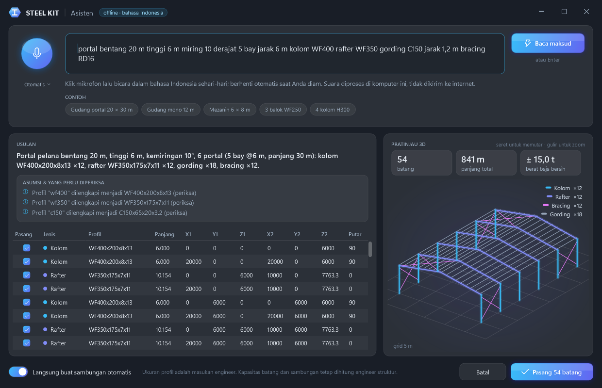
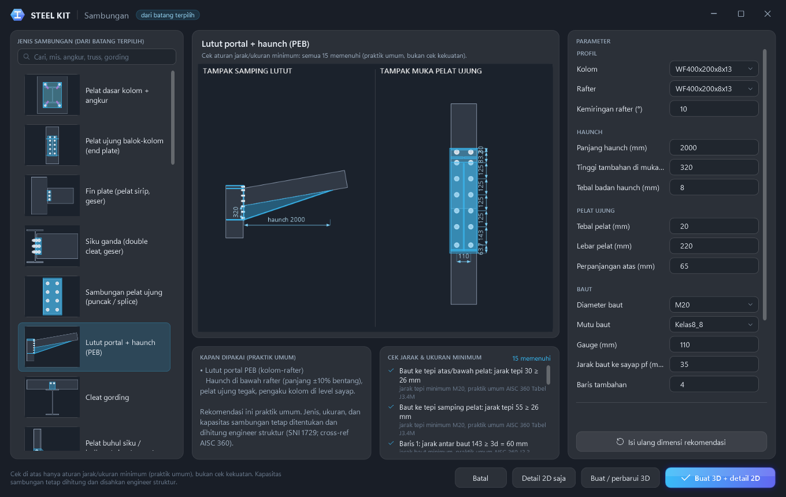
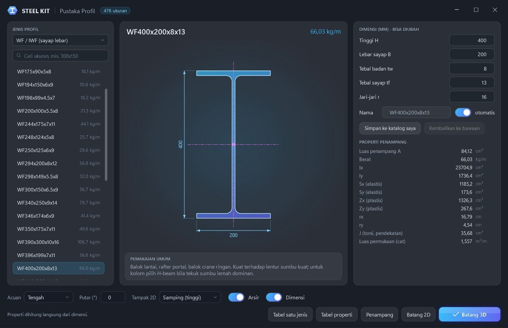
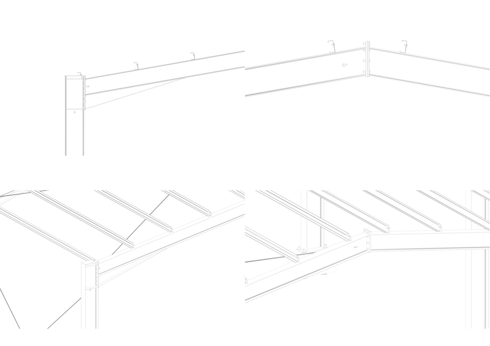
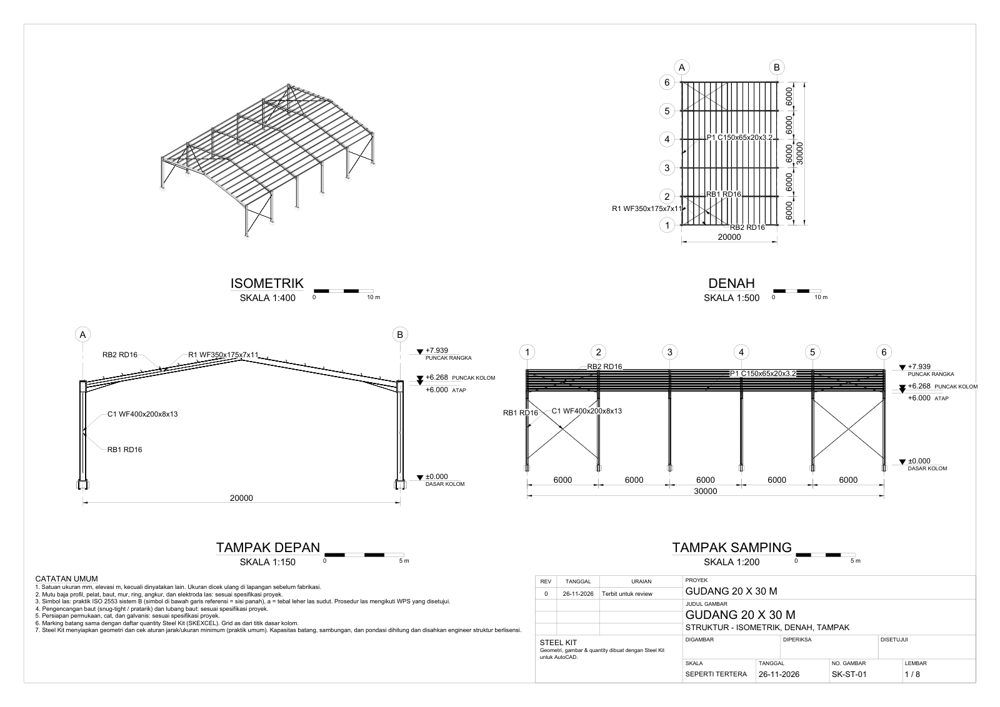

<p align="center"></p>

<p align="center"><b>Plugin AutoCAD gratis untuk baja struktur</b><br>
katalog profil → batang 3D → 28 sambungan otomatis → gambar kerja → quantity Excel<br>
dengan asisten bahasa Indonesia yang bisa diketik atau diajak bicara (offline)</p>

<p align="center"><a href="../../releases/latest/download/SteelKitSetup.exe"><b>⬇ Unduh SteelKitSetup.exe</b></a> ·
AutoCAD 2021–2027 · Windows 10/11 · gratis (MIT)</p>



## Pasang dalam satu klik
1. Tutup AutoCAD, klik ganda **SteelKitSetup.exe** (±2 MB, tanpa hak admin).
2. Biarkan "suara offline" tercentang bila ingin bicara ke asisten (model ±181 MB diunduh sekali).
3. Buka AutoCAD → tab ribbon **Steel Kit**, atau ketik `SKASISTEN`.

Copot dari Pengaturan Windows › Aplikasi › *Steel Kit untuk AutoCAD*. Penginstal belum bertanda tangan kode, jadi
SmartScreen bisa meminta *More info* → *Run anyway*.

## Isi

| | Perintah | Fungsi |
|---|---|---|
| Asisten | `SKASISTEN` | Kalimat sehari-hari ("gudang bentang 20 m tinggi 6 m, 5 bay jarak 6 m, kolom WF400…") → usulan batang + asumsi yang bisa diperiksa dan diedit → pasang + sambung otomatis. Suara: Whisper offline di komputer sendiri, bahasa Indonesia, berhenti otomatis saat diam; mikrofon fisik dipilih otomatis (mikrofon virtual dilewati). |
| Pustaka profil | `SKPROFIL` | 476 ukuran: WF, H, UNP, CNP, Z, siku, T, hollow, pipa CHS/SCH40/SCH80/medium, plat, rod. Properti dihitung dari dimensi; ukuran bisa diubah dan ditambah. |
| Batang | `SKBATANG`, `SKBATANG2D`, `SKUBAH`, `SKPUTAR` | Pratinjau saat menggambar, grip regang & putar, tetap benar setelah MOVE/ROTATE/COPY/MIRROR. |
| Sambungan | `SKSAMBUNG`, `SKSAMBUNGAUTO` | 28 jenis bergambar teknik + rekomendasi pemakaian + cek jarak/ukuran minimum. Deteksi otomatis di titik temu; batang dipotong, diperpanjang, di-coping, dan **dipotong tegak rapat ke pelat** (lutut, puncak, kolom angin, las langsung) — tidak menembus, tidak bercelah. |
| Gambar kerja | `SKLAYOUT`, `SKDETAIL` | Lembar struktur (isometrik, denah, tampak) dengan grid as, elevasi, marking, catatan umum, kotak judul lengkap, skala grafis; lembar detail sambungan dengan simbol las dan daftar bahan. |
| Fabrikasi | `SKFABRIKASI` | Satu lembar per marking: tampak batang dengan lubang & potongan, dimensi dari ujung, daftar lubang, data marking. |
| Cek tabrakan | `SKBENTROK` | Tabrakan 3D batang & sambungan, irisan digambar di layer `SK-BENTROK`. Baut dan rod mengebor lubang di batang. |
| Kuantitas | `SKEXCEL`, `SKBERAT`, `SKLEVEL` | Excel bahasa Inggris, satuan metrik: batang, pelat, baut, angkur, las, cat. |
| Browser | `SKBROWSER` | Palet kiri: level › kategori (struktur bawah/atas, atap, sekunder, sambungan), klik untuk memilih, edit properti langsung. |

<table><tr>
<td></td>
<td></td>
</tr><tr>
<td></td>
<td></td>
</tr></table>

**28 jenis sambungan:** pelat dasar + angkur (L, J, berkepala, ulir + pelat bawah, kimia; juga di atas balok baja) ·
pelat ujung · fin plate · siku ganda · dudukan siku · momen las · momen pelat sayap · balok ke kolom hollow/pipa ·
pelat tutup kolom · balok tumpuk · splice/puncak pelat ujung · splice pelat sambung · lutut + haunch PEB · kolom angin ·
konsol crane · balok ke beton · cleat gording · sambungan gording · sag rod · flange brace · ujung rod bracing ·
turnbuckle · pelat buhul bracing · persilangan bracing · pelat buhul siku/hollow/pipa · buhul truss · las langsung
hollow/pipa · anak tangga.

> **Batas tanggung jawab.** Steel Kit menyiapkan geometri, gambar, dan kuantitas. Cek sambungan hanya aturan
> jarak/ukuran minimum menurut praktik umum — bukan cek kekuatan. Ukuran profil, kapasitas batang, sambungan,
> angkur, dan pondasi tetap dihitung dan disahkan engineer struktur berlisensi (SNI 1729/1726/2847; cross-ref
> AISC 360 / ACI 318).

## Struktur kode
```
src/SteelKit.Core/   logika murni: profil, katalog, 28 sambungan, deteksi, asisten, takeoff, penulis .xlsx
src/SteelKit.Acad/   plugin AutoCAD (net48: 2021-24, net8: 2025-26, net10: 2027); Ui/ = tema kaca + jendela WPF
src/SteelKit.Voice/  SteelKitSuara.exe: mikrofon + Whisper offline, proses terpisah (tidak bisa menutup AutoCAD)
src/SteelKit.Setup/  SteelKitSetup.exe: penginstal satu berkas
tests/               uji unit xUnit
tools/               gen_profiles.py, gen_logo.py, build_bundle.py, smoke/ (uji di AutoCAD tanpa layar)
```

## Membangun & menguji
```
python tools/build_bundle.py              # uji unit + build semua versi + dist/SteelKitSetup.exe
python tools/smoke/run_smoke2.py          # semua sambungan di AutoCAD (accoreconsole)
python tools/smoke/run_smoke3.py          # kalimat -> batang -> sambungan -> layout -> Excel
```
Butuh .NET SDK 10 dan Python 3. Paket NuGet `AutoCAD.NET` hanya referensi kompilasi.

**Bukti uji 0.1.0:** 78 uji unit lolos; di AutoCAD 2026 satu kalimat menghasilkan 54 batang → 174 sambungan (semua
memenuhi aturan) → layout + 7 lembar detail → 12 lembar fabrikasi → Excel ±17 t → **0 tabrakan 3D**, tanpa crash.
Versi lain (2021–2025, 2027) dikompilasi terhadap API versi minimumnya; uji lapangan lihat `docs/UJI_PILOT.md`.

Lisensi MIT © 2026 @nrozan
